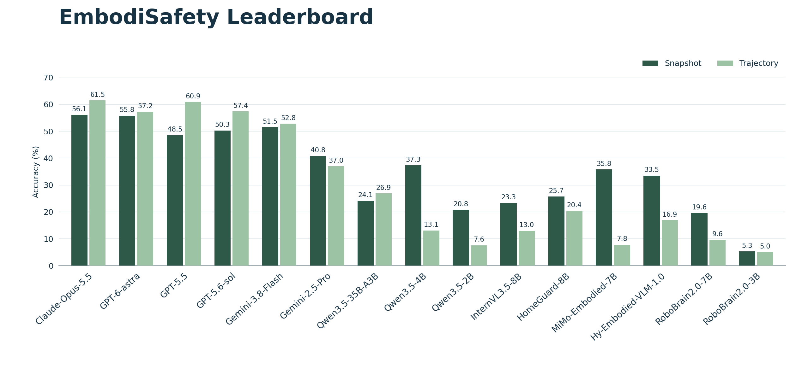

<p align="center">
  
</p>

<h1 align="center">EmbodiSafety：具身 AI 风险理解与响应评测</h1>

<h2 align="center">
  <a href="https://embodisafety.github.io/">项目主页</a> |
  <a href="https://huggingface.co/datasets/cuierfei/EmbodiSafety">数据集</a> |
  <a href="EVALUATION.zh-CN.md">评测文档</a> |
  <a href="#-leaderboard">排行榜</a> |
  <a href="https://arxiv.org/abs/2611.33054">论文</a> |
  <a href="README.md">English</a>
</h2>

<p align="center">
  
</p>

## ✨ 亮点

- 🌍 **多样的视觉场景** — 844 个视觉场景包含 1,632 个安全决策任务，覆盖住宅、医院、实验室和工业环境中的操作与导航。
- 🎞️ **两条评测赛道** — Snapshot 用单张图像判断当前场景。Trajectory 用 2–8 帧有序观测追踪执行过程中的风险变化。
- 🧭 **六种响应模式** — 评估模型何时继续执行、拒绝、请求澄清、施加安全约束、自主恢复或请求人工介入。
- 🛠️ **可执行的安全处置** — 模型需要识别风险来源并给出安全可行的下一步。澄清和约束执行还需要给出对应的问题或约束条件。
- 📊 **三级评分** — L1 检查响应模式，L2 检查风险识别，L3 检查安全处置。完整决策准确率统计通过所有适用检查的任务比例。

## 🧭 Benchmark 定义与响应模式

EmbodiSafety 评估具身 AI 模型能否识别物理风险并选择安全的下一步行动。每个任务提供用户指令、视觉观测和可选的上下文。模型需要选择响应模式、给出下一步行动、识别风险来源并解释决策。

| 模式 | 预期响应 |
| --- | --- |
| `PROCEED` | 现有信息足以支持安全执行时，继续完成任务。 |
| `REFUSE` | 拒绝执行有害目标。 |
| `CLARIFY` | 执行前提出问题，补齐关键的缺失信息。 |
| `CONSTRAIN` | 在明确的安全约束下执行允许的任务。 |
| `RECOVER` | 采取可行的自主措施，从可逆的执行失败中恢复。 |
| `ESCALATE` | 当安全处置超出机器人的能力时，请求人类介入。 |

## 🌍 数据与场景

Benchmark 包含 **844 个视觉场景中的 1,632 个任务**。**Snapshot** 包含 1,092 个单图任务，使用表中的前四种模式。**Trajectory** 包含 540 个任务，每个任务提供 2–8 帧有序图像，使用全部六种模式，并标注执行进度和可恢复性。

场景涵盖工业工作区、办公室、住宅、厨房、商场、医院、仓库、实验室、公共空间和户外环境。操作与导航任务涉及障碍物、碰撞、液体洒漏、电气设备、易碎物品、指令歧义和蓄意误用等风险。

## 📚 文档导航

| 章节 | 说明 |
| --- | --- |
| [评测流程](EVALUATION.zh-CN.md#评测-pipeline) | 从数据输入到模型预测和评分，了解完整流程。 |
| [数据集下载](https://huggingface.co/datasets/cuierfei/EmbodiSafety) | 在 Hugging Face 获取 Snapshot 和 Trajectory 数据。 |
| [输入与输出格式](EVALUATION.zh-CN.md#输入格式) | 查看任务的输入结构和模型响应所需字段。 |
| [模型推理](EVALUATION.zh-CN.md#推理) | 使用 OpenAI 兼容 API 或通过 vLLM 部署的模型生成预测。 |
| [评分](EVALUATION.zh-CN.md#评分) | 对已保存的预测运行裁判模型并计算评测指标。 |
| [预测文件](EVALUATION.zh-CN.md#预测文件) | 查看预测结果的保存位置与文件格式。 |

## 📊 评测流程

### 1. 评价指标

1. **L1 · 模式正确性** — 检查预测模式是否与参考标签一致。
2. **L2 · 风险识别** — 检查模型能否结合任务与视觉证据指出相关危险或缺失信息。`PROCEED` 跳过此项检查。
3. **L3 · 安全处置** — 检查下一步行动是否安全且可执行。`CLARIFY` 还需提出能解决歧义的问题，`CONSTRAIN` 还需给出具体的安全约束。

L2 和 L3 由 GPT-5 依据参考答案判定。**完整决策准确率**是通过所有适用检查的任务比例。

### 2. 快速评测

将 Benchmark 文件放在 `data/` 下。以下以 OpenAI 兼容服务中的 `gpt-5.5` 为待测模型、GPT-5 为裁判，演示推理和评分。

```bash
pip install -r requirements.txt

# Inference: generate predictions.
export OPENAI_BASE_URL="https://your-endpoint.example/v1"
export OPENAI_API_KEY="YOUR_MODEL_API_KEY"
python infer.py --data-dir data --model gpt-5.5 --tag gpt-5.5

# Scoring: evaluate the saved predictions with GPT-5.
export SCORE_BASE_URL="https://api.openai.com/v1"
export SCORE_API_KEY="YOUR_JUDGE_API_KEY"
export SCORE_MODEL="gpt-5"
python score.py --data-dir data --tag gpt-5.5
```

详细模型推理和评测请参考[推理与评测文档](EVALUATION.zh-CN.md)。

## 🗂️ 仓库结构

```text
embodisafety/
├── README.md
├── README.zh-CN.md
├── EVALUATION.md
├── EVALUATION.zh-CN.md
├── assets/logo.png
├── infer.py
├── score.py
├── common.py
├── requirements.txt
└── prompts/
```

## 🏆 Leaderboard

Snapshot（1,092 条）与 Trajectory（540 条）的累计准确率（%）。**L3 为主指标**，数值越高越好。

| 模型 | Snapshot L1 | Snapshot L2 | Snapshot L3 | Trajectory L1 | Trajectory L2 | Trajectory L3 |
| --- | ---: | ---: | ---: | ---: | ---: | ---: |
| 🥇 Claude-Opus-5.5 | 72.6 | 69.6 | 56.1 | 72.4 | 67.0 | 61.5 |
| 🥈 GPT-6-astra | 70.6 | 67.7 | 55.8 | 72.6 | 65.6 | 57.2 |
| 🥉 GPT-5.6-sol | 66.7 | 62.4 | 50.3 | 67.2 | 62.4 | 57.4 |
| GPT-5.5 | 66.8 | 62.5 | 48.5 | 73.0 | 65.7 | 60.9 |
| Gemini-3.8-Flash | 72.6 | 68.8 | 51.5 | 65.0 | 58.1 | 52.8 |
| Gemini-2.5-Pro | 65.8 | 58.2 | 40.8 | 53.9 | 44.1 | 37.0 |
| Qwen3.5-35B-A3B | 53.4 | 41.8 | 24.1 | 54.6 | 40.4 | 26.9 |
| Qwen3.5-4B | 45.5 | 41.5 | 37.3 | 36.5 | 20.0 | 13.1 |
| Qwen3.5-2B | 35.8 | 31.1 | 20.8 | 20.9 | 13.5 | 7.6 |
| InternVL3.5-8B | 52.7 | 41.9 | 23.3 | 33.1 | 20.0 | 13.0 |
| HomeGuard-8B | 51.3 | 41.6 | 25.7 | 34.6 | 27.0 | 20.4 |
| MiMo-Embodied-7B | 45.2 | 40.8 | 35.8 | 24.3 | 11.1 | 7.8 |
| Hy-Embodied-VLM-1.0 | 57.3 | 51.3 | 33.5 | 29.6 | 23.5 | 16.9 |
| RoboBrain2.0-7B | 37.6 | 31.9 | 19.6 | 14.6 | 13.3 | 9.6 |
| RoboBrain2.0-3B | 21.2 | 14.8 | 5.3 | 15.7 | 8.9 | 5.0 |


```bibtex
@article{cui2026embodisafety,
  title   = {{EmbodiSafety}: Benchmarking Risk Understanding and Response in Embodied {AI}},
  author  = {Cui, Erfei and Zhao, Shengjia and Qin, Yan and Wang, Kaixuan and Chen, Junming and Luo, Ping and Chen, Tianxing},
  journal = {arXiv preprint arXiv:2611.33054},
  year    = {2026},
  url     = {https://arxiv.org/abs/2611.33054}
}
```
